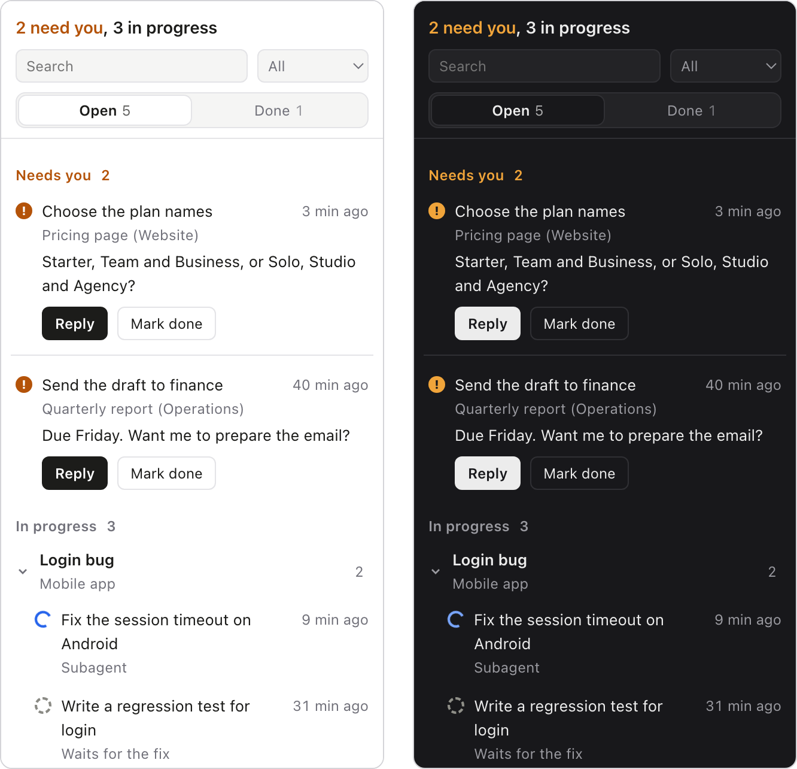

# Requests

Follow what you ask Claude for, one thread at a time.

When you send Claude Code several things in one message, Requests splits them into separate requests, groups them by topic and tracks each one's status. [Orca](https://github.com/stablyai/orca) shows them in a sidebar panel, with a status bar counter for anything that needs your input.



## How it works

Requests has two parts that share one file, `~/.requests/requests.json`:

- **A Claude Code plugin** gives Claude its instructions at the start of every session, plus a small command to log and update requests.
- **An Orca plugin** watches that file and shows it as a panel in the right sidebar and a counter in the status bar.

Everything stays on your computer. There are no dependencies to install.

## Requirements

- [Orca](https://github.com/stablyai/orca) 1.4.248 or later
- [Claude Code](https://claude.com/claude-code)
- Node.js 18 or later

## Install

1. **Orca**, in a terminal:

   ```sh
   orca plugin install sydneyhylia/requests
   ```

   Orca shows what the plugin needs (it runs its own code, nothing else) and gives you the same command with `--approve` to confirm.

2. **Claude Code**:

   ```
   /plugin marketplace add sydneyhylia/requests
   /plugin install requests@requests
   ```

3. Start a new Claude Code session.

## Usage

- Talk to Claude as usual. When it logs something, it adds a line like `→ 2 requests logged: Pricing page (1), Login bug (1)`.
- Open the flag icon in Orca's right sidebar. Anything that needs you is listed first.
- To answer one, press **Reply**, paste the reference into Claude's terminal and write after it: `[k3fp] the second option`.

Quick questions Claude answers on the spot aren't logged. Anything that involves work is, even if it's finished in the same reply.

## Updating

```sh
orca plugin update
```

In Claude Code: `/plugin marketplace update requests`

## Notes

- If Claude Code asks for permission every time it logs a request, allow `node …/requests.mjs` in `/permissions`.
- The list is per computer. It doesn't sync between machines.
- Orca doesn't let plugins jump to a point in the chat or open their own panel, so the panel shows Claude's answer inline and the counter is informational.

## Development

Load this folder in both apps:

- **Orca:** Settings → Plugins → Development folders, or `orca plugin dev load <folder>`.
- **Claude Code:** `claude plugin marketplace add <folder>`, then `claude plugin install requests@requests`.

Orca reloads the plugin when its files change. `node claude/bin/requests.mjs help` lists the commands Claude uses.

## License

[MIT](LICENSE) © 2026 Sydney
