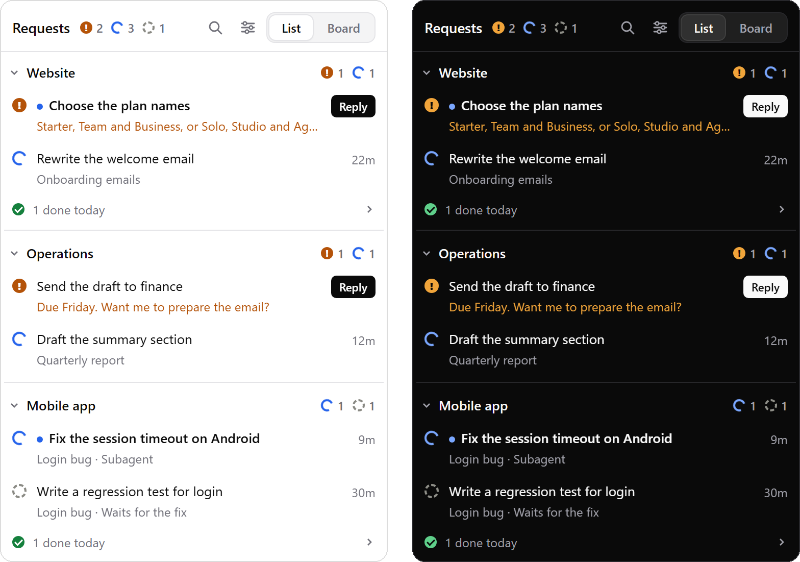

# Requests

Follow what you ask Claude for, one thread at a time.

When you send Claude Code several things in one message, Requests splits them into separate requests, groups them by project and topic, and tracks each one's status. [Orca](https://github.com/stablyai/orca) shows them in a sidebar panel, with a status bar counter for anything that needs your input.



## How it works

Requests has two parts that share one file, `~/.requests/requests.json`:

- **A Claude Code plugin** gives Claude its instructions at the start of every session, plus a small command to log and update requests. Each request remembers the Orca chat it was last updated from.
- **An Orca plugin** watches that file and shows it as a panel in the right sidebar and a counter in the status bar.

The list follows your topics, not your sessions: a request stays open until it's addressed, even if the chat it came from has closed.

Everything stays on your computer. There are no dependencies to install.

## Requirements

- [Orca](https://github.com/stablyai/orca) 1.4.248 or later
- [Claude Code](https://claude.com/claude-code)
- Node.js 18 or later

## Install

1. **Orca**, in a terminal. Orca has no command that installs a plugin from GitHub, so you load a copy of this repo as a development folder:

   ```sh
   git clone https://github.com/sydneydesign/requests
   orca plugin dev load requests
   ```

   Orca shows what the plugin needs (it runs its own code, nothing else) and gives you the same command with `--approve` to confirm.

2. **Claude Code**:

   ```
   /plugin marketplace add sydneydesign/requests
   /plugin install requests@requests
   ```

3. Start a new Claude Code session.

## Usage

- Talk to Claude as usual. When it logs something, it adds a line like `→ 2 requests logged: Pricing page (1), Login bug (1)`.
- Open the flag icon in Orca's right sidebar. Requests are grouped by project. Inside each project, what needs you comes first, then what is in progress, then what is queued. Done requests fold into one line per project.
- Use the display button (the sliders icon) to group by status instead, pick one project, or show all done requests instead of today's.
- New updates from Claude show in bold with a dot. They count as read once you open them in the panel or write in the chat they came from.
- To answer one, press **Go to chat**. Orca switches to the chat the request came from and copies its reference, so you can paste it and write after it: `[k3fp] the second option`. When you answer, Claude moves the request on.

### Board

Press **Board** at the top of the panel to open the requests in a full-width tab, with a **Board** view (one column per status) and a **List** view (the panel at full width).

- Orca opens the board on `~/.requests/requests.json`. The first time, Orca adds `~/.requests` as a folder workspace in the left sidebar. The board never edits the file directly.
- Click a card to see what you said and Claude's last answer, with **Go to chat** and **Mark done**.
- A done request stays on the board while the chat it came from is open in Orca. **Clear** hides every done request on the board. The panel keeps them all: set Done to All in its display menu.
- Close the right sidebar to give the board the full width. In a narrow tab, the columns snap and "Needs you" stays pinned on the left.

| Status | Meaning |
| --- | --- |
| Needs you | Claude is waiting for a decision, an answer or something only you can do. |
| In progress | Claude, a subagent or another session is working on it. |
| Queued | It's waiting for something else to finish first. |
| Done | It's addressed. You can reopen it from the panel. |

A request in progress with no update for over 30 minutes shows "idle" and how long, in orange. It is probably finished and never closed: mark it done, or tell Claude. Claude also gets a reminder about its own idle requests with every message.

The file stores the statuses as short codes: `need`, `run`, `queue` and `done`. Claude's command takes them as `needs-you`, `working`, `queued` and `done`.

The status bar counter turns orange only when something new needs you. Quick questions Claude answers on the spot aren't logged; anything that involves work is, even if it's finished in the same reply.

## Updating

Orca, in the folder you cloned:

```sh
git pull
```

Orca reloads the plugin when its files change. If the new version asks for new access, the panel stops until you approve it. `orca plugin list` shows it as `pending`. Run `orca plugin dev load <folder>` and confirm with the `--approve` command it prints.

In Claude Code: `/plugin marketplace update requests`, then start a new session.

## Notes

- If Claude Code asks for permission every time it logs a request, allow `node …/requests.mjs` in `/permissions`.
- The list is per computer. It doesn't sync between machines.
- **Go to chat** opens the chat's tab, not a specific message in it. Requests logged before version 0.4.0 don't know their chat, so they offer **Copy reference** instead.
- Clicking the counter doesn't open the panel, because Orca doesn't let plugins open their own panel.

## Development

Load this folder in both apps:

- **Orca:** Settings → Plugins → Development folders, or `orca plugin dev load <folder>`.
- **Claude Code:** `claude plugin marketplace add <folder>`, then `claude plugin install requests@requests`.

Orca reloads the plugin when its files change. `node claude/bin/requests.mjs help` lists the commands Claude uses.

`dev/board-harness.html` renders the board and panel against test data in any browser, without Orca. Use `?data=demo|worst|empty|one|huge`, `&theme=light|dark` and `&view=board|list`. It is not part of the plugin.

## License

[MIT](LICENSE) © 2026 Sydney
